# Piul Cell

Toko online untuk jual HP dan aksesoris. Ada tiga jenis pengguna: pembeli, admin toko, dan owner. Dibuat pakai PHP native dengan struktur MVC sederhana yang khusus untuk proyek ini (tanpa Laravel/CodeIgniter) dan database MySQL.

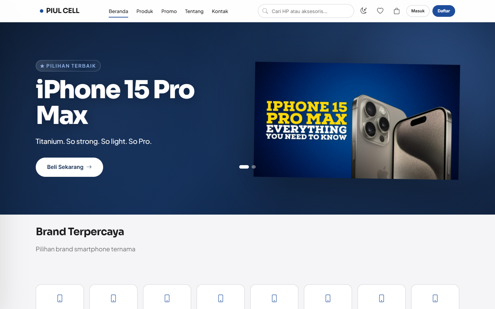

## Fitur

**Pembeli**
- Lihat katalog produk, filter berdasarkan brand, kategori, dan promo, serta urutkan berdasarkan terbaru, terpopuler, harga, atau rating
- Pencarian produk dengan saran otomatis
- Halaman detail produk dengan pilihan varian (storage dan warna), stok dan harga mengikuti varian yang dipilih
- Keranjang belanja (tambah/ubah/hapus tanpa reload halaman)
- Checkout dengan kode voucher dan ongkir yang dihitung dari jarak alamat ke toko
- Pembayaran via transfer bank, QRIS, atau COD, lalu upload bukti transfer
- Riwayat pesanan, detail pesanan, nomor resi, dan konfirmasi pesanan diterima
- Wishlist, ulasan produk, notifikasi, kelola alamat dan profil
- Invoice yang bisa dicetak atau disimpan jadi PDF

**Admin**
- Dashboard ringkasan: pesanan hari ini, revenue, pesanan tertunda, stok menipis, grafik 7 hari
- Kelola produk beserta variannya, brand, dan kategori
- Kelola pesanan: ubah status, input nomor resi
- Verifikasi bukti pembayaran
- Kelola rekening bank dan QRIS toko
- Kelola voucher, banner, ulasan, data pelanggan, zona pengiriman, pengaturan toko, dan akun admin

**Owner**
- Dashboard: total revenue, jumlah pesanan, rata-rata nilai order, tren pendapatan 6 bulan
- Analitik: funnel (dilihat → masuk keranjang → order → dibayar) dan performa tiap produk
- Laporan keuangan per bulan dan laporan per periode
- Export laporan ke CSV dan PDF

Selain itu ada dark mode (pilihan disimpan di browser) dan tampilan sudah menyesuaikan layar HP.

## Screenshot

### Pembeli

| Katalog | Detail produk |
|---|---|
| 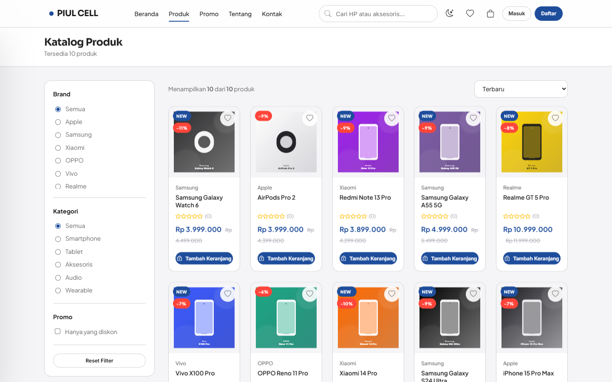 | 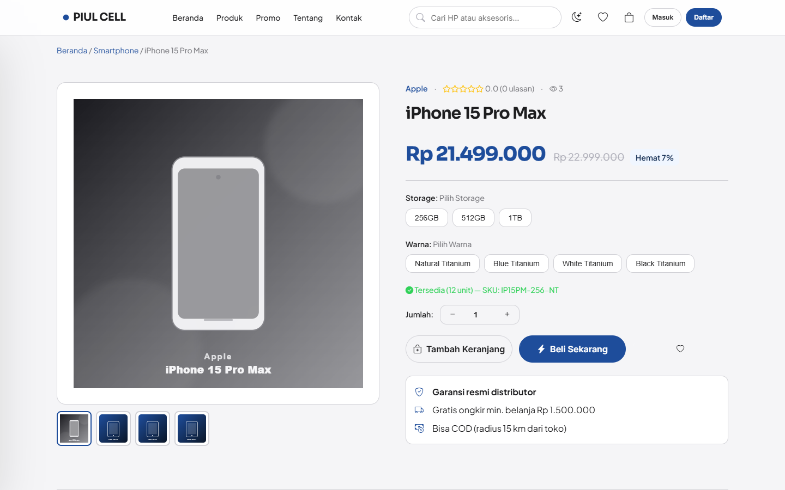 |

| Pesanan saya | Detail pesanan |
|---|---|
| 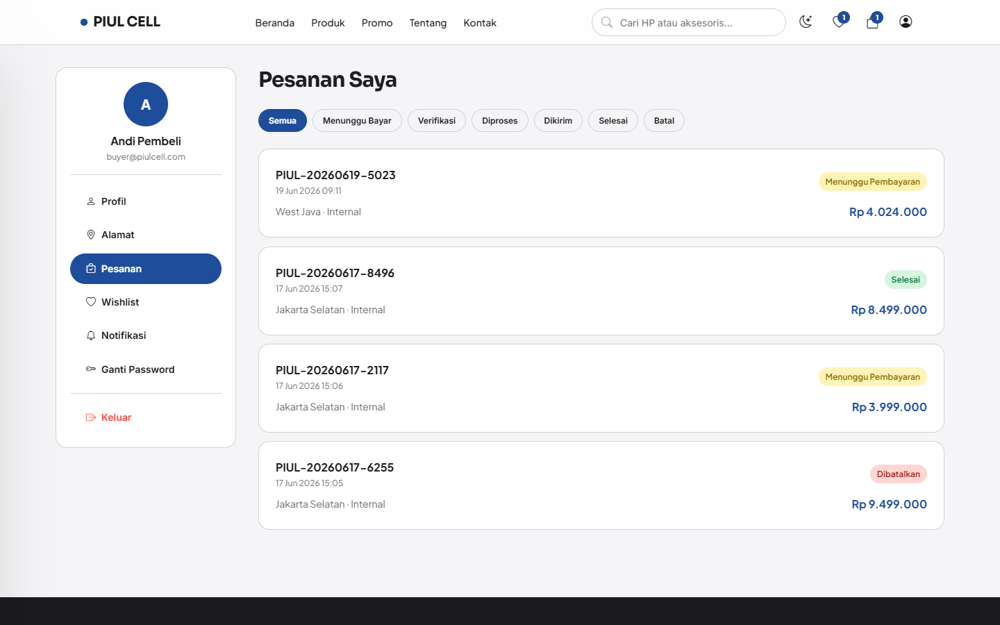 | 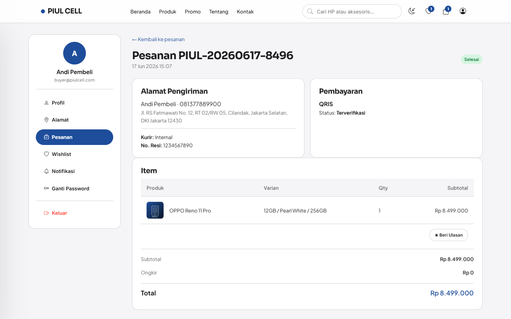 |

| Invoice | Login |
|---|---|
| 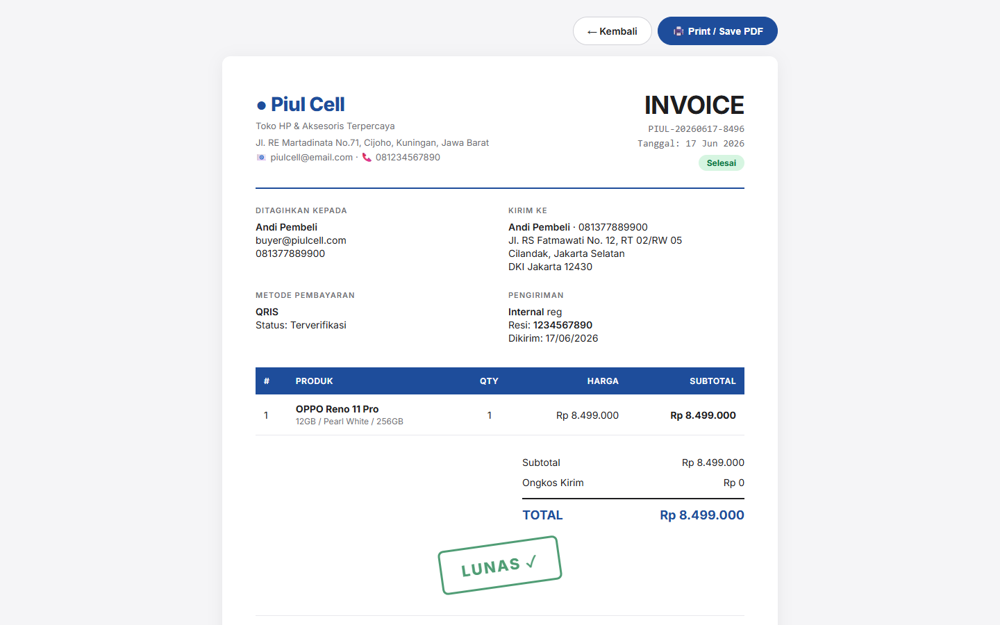 | 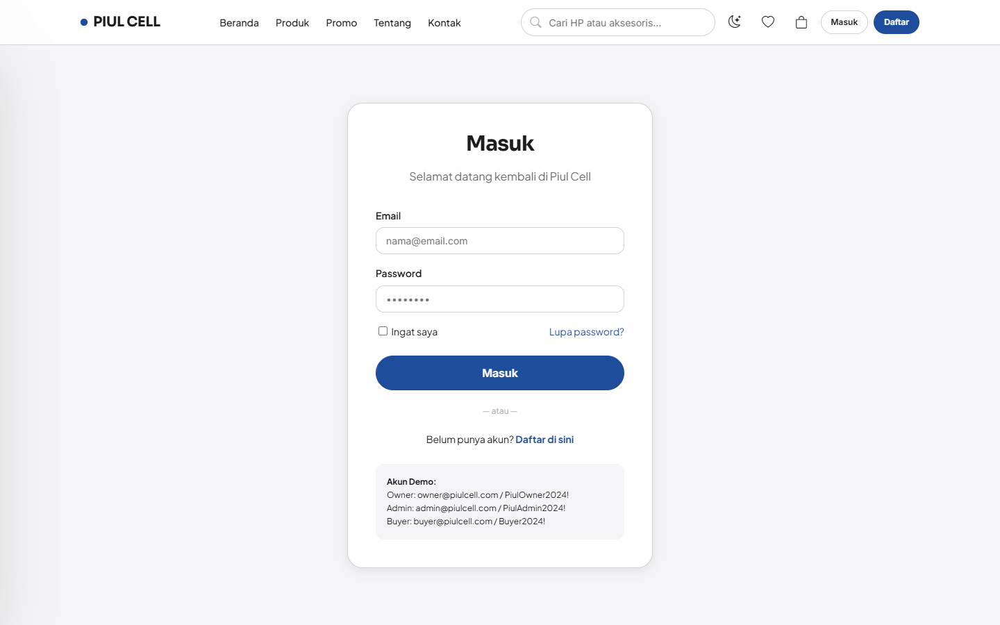 |

### Admin

| Dashboard | Produk |
|---|---|
| 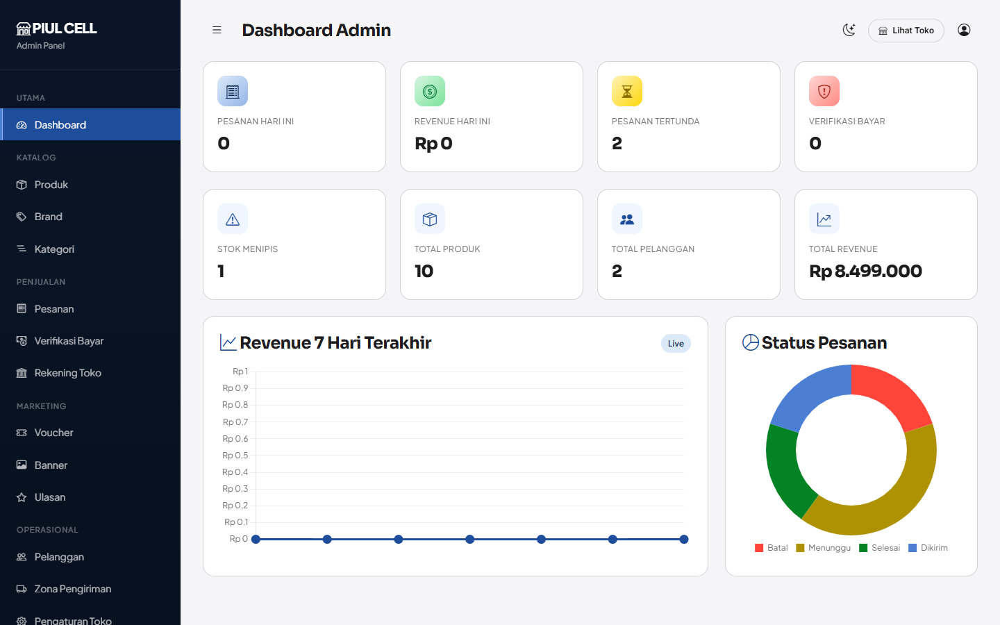 | 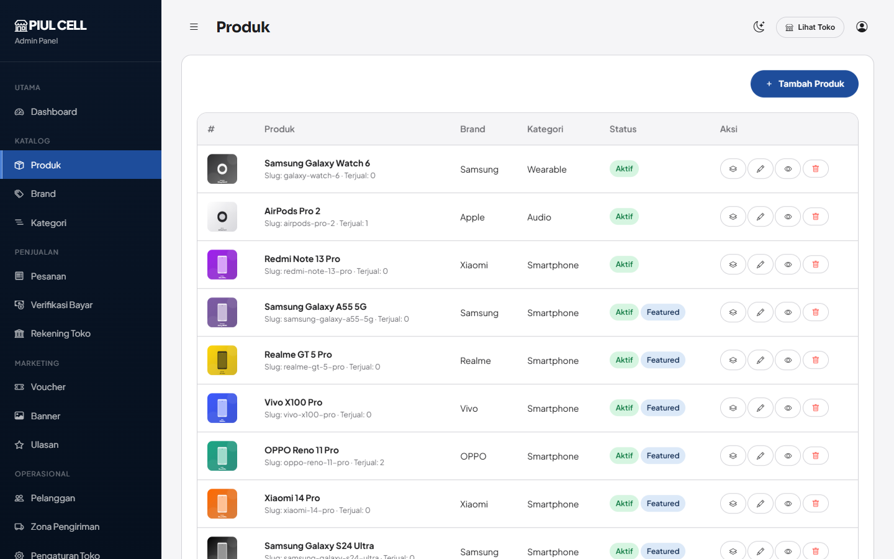 |

Daftar pesanan (dark mode):

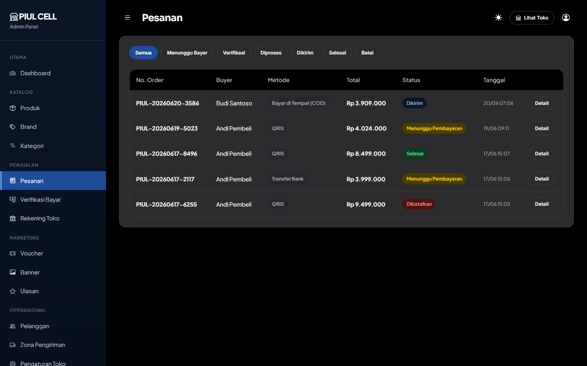

### Owner

| Dashboard | Analitik |
|---|---|
| 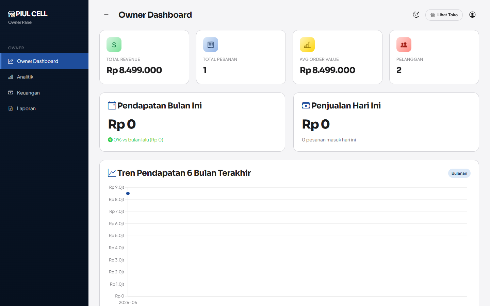 | 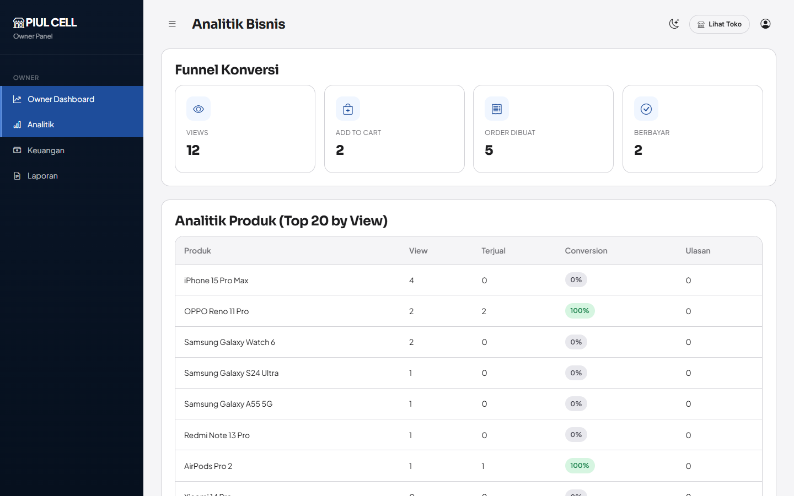 |

Laporan keuangan:

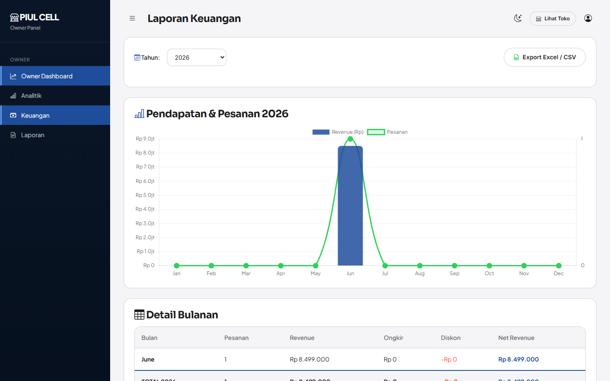

### Dark mode

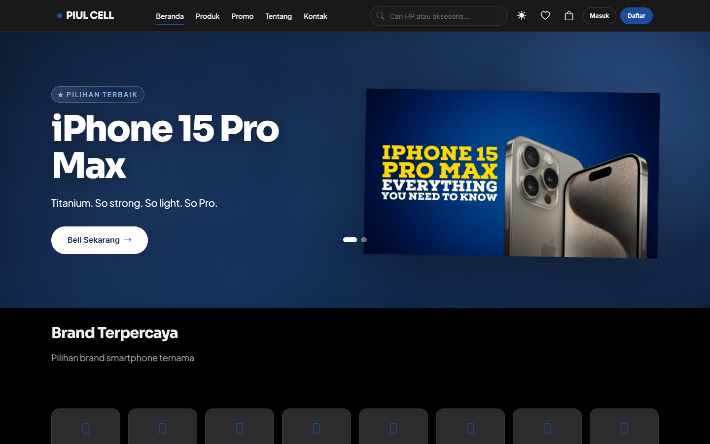

## Teknologi

- PHP 7.4 / 8.x
- MySQL 5.7+ atau MariaDB 10.3+ (akses lewat PDO, semua query pakai prepared statement)
- HTML, CSS, dan JavaScript biasa (tanpa framework frontend), AJAX untuk keranjang dan checkout
- Chart.js untuk grafik di dashboard admin dan owner
- Nominatim (OpenStreetMap) untuk mengubah alamat jadi koordinat, lalu rumus Haversine untuk menghitung jarak dan ongkir
- Bootstrap Icons, font Plus Jakarta Sans dan Sora

## Cara kerja singkat

Semua request masuk ke `public/index.php`. Dari sana `Router` mencocokkan URL dengan daftar rute di `app/routes.php`, lalu memanggil method di controller yang sesuai. Controller mengambil data lewat class `Database` (PDO) dan menampilkan view dari folder `app/Views`.

Hak akses dicek di base `Controller`: halaman `/admin` hanya untuk admin, `/owner` hanya untuk owner, dan halaman akun hanya untuk user yang sudah login. Form POST dan request AJAX dilindungi token CSRF.

## Struktur folder

```
piulcell/
├── public/              # index.php (entry point) dan router.php untuk php -S
├── app/
│   ├── Core/            # Router, Controller dasar, Database, helper
│   ├── Controllers/     # controller pembeli, Admin/, Owner/
│   ├── Views/           # layout, partial, dan halaman per modul
│   └── routes.php       # daftar semua URL
├── assets/              # css, js, gambar produk/brand/banner
├── uploads/             # file upload (foto produk, bukti bayar, QRIS, dll)
├── database/            # schema.sql dan seed.sql
├── docs/screenshots/    # gambar untuk README ini
├── logs/
└── storage/sessions/
```

## Instalasi

Yang dibutuhkan: PHP 7.4 ke atas (ekstensi `pdo_mysql`, `mbstring`, `gd`) dan MySQL/MariaDB. Di Windows paling mudah pakai Laragon atau XAMPP.

1. Clone repo

   ```bash
   git clone https://github.com/ucuf-cyber/piulcell.git
   cd piulcell
   ```

2. Buat database lalu import struktur dan data contohnya

   ```bash
   mysql -u root -e "CREATE DATABASE piulcell_db CHARACTER SET utf8mb4 COLLATE utf8mb4_unicode_ci"
   mysql -u root piulcell_db < database/schema.sql
   mysql -u root piulcell_db < database/seed.sql
   ```

   Data contoh berisi 10 produk, 25 varian, 8 brand, 3 akun, beberapa voucher, dan banner.

3. Kalau user/password MySQL kamu bukan `root` tanpa password, ubah di `app/Core/Database.php`:

   ```php
   'mysql:host=127.0.0.1;port=3306;dbname=piulcell_db;charset=utf8mb4',
   'root',   // username
   '',       // password
   ```

4. Jalankan

   ```bash
   php -S localhost:8080 -t public public/router.php
   ```

   Lalu buka http://localhost:8080

Panduan lebih lengkap untuk Laragon (termasuk import lewat HeidiSQL) ada di [TUTORIAL_LARAGON.md](TUTORIAL_LARAGON.md).

## Akun demo

| Role | Email | Password |
|---|---|---|
| Owner | owner@piulcell.com | PiulOwner2024! |
| Admin | admin@piulcell.com | PiulAdmin2024! |
| Pembeli | buyer@piulcell.com | Buyer2024! |

Kode voucher yang bisa dicoba:

| Kode | Keterangan |
|---|---|
| PIULCELL10 | Diskon 10%, maksimal Rp200.000, minimal belanja Rp1.000.000 |
| GRATIS50 | Potongan Rp50.000, minimal belanja Rp500.000 |
| FREEONGKIR | Gratis ongkir |

## Daftar URL

| Bagian | URL |
|---|---|
| Umum | `/`, `/katalog`, `/produk/{slug}`, `/cari`, `/page/{slug}` |
| Login | `/login`, `/register`, `/logout`, `/forgot-password`, `/reset-password` |
| Pembeli | `/cart`, `/checkout`, `/payment/instructions/{id}`, `/akun`, `/akun/alamat`, `/akun/pesanan`, `/akun/wishlist`, `/akun/notifikasi`, `/invoice/{id}` |
| Admin | `/admin/dashboard`, `/admin/products`, `/admin/brands`, `/admin/categories`, `/admin/orders`, `/admin/payments/pending`, `/admin/payment-accounts`, `/admin/vouchers`, `/admin/banners`, `/admin/reviews`, `/admin/customers`, `/admin/shipping-zones`, `/admin/settings`, `/admin/users` |
| Owner | `/owner/dashboard`, `/owner/analytics`, `/owner/financial`, `/owner/reports` |

## Masalah yang sering muncul

- **Halaman selain beranda 404, atau CSS/gambar tidak muncul.** Folder `assets` dan `uploads` ada di luar `public`, jadi jalankan pakai `php -S ... public/router.php` seperti di langkah 4. Kalau pakai Apache, arahkan document root ke folder `public` dan aktifkan `mod_rewrite`.
- **Tidak bisa konek ke database.** Pastikan MySQL sudah jalan dan username/password di `app/Core/Database.php` benar.
- **Upload bukti bayar gagal.** Pastikan folder `uploads` bisa ditulis. Di Linux: `chmod -R 775 uploads`.

## Lisensi

MIT. Lihat file [LICENSE](LICENSE).

Dibangun dengan bantuan E1 (Emergent AI).
